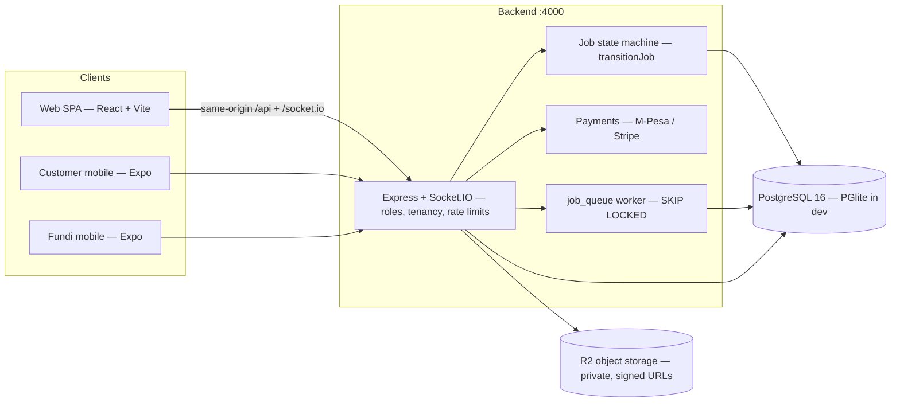
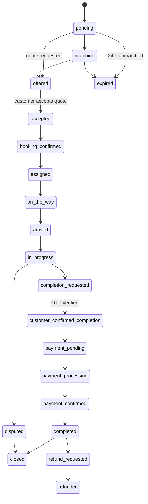
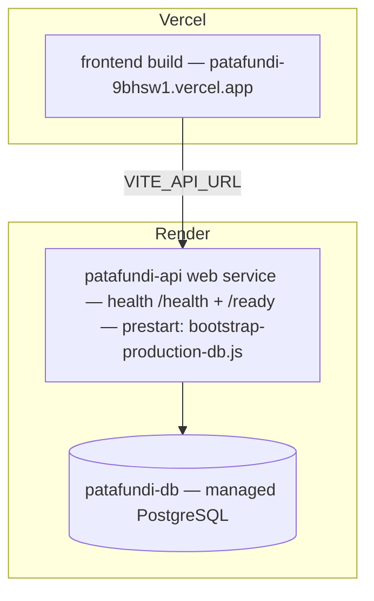

# PataFundi

A production-grade on-demand home services marketplace connecting customers with verified individual fundis and professional service companies across Kenya. **One project. One codebase. One ecosystem.**

## Project Structure (one monorepo)

```
patafundi/
├── backend/                  Express API + PostgreSQL (PGlite embedded for dev)
│   ├── src/server.js         API entry — port 4000
│   ├── src/routes.js         All /api/* routes
│   ├── src/controllers/      Auth, jobs, payments, companies, staff, admin…
│   ├── src/services/         Money, matching, fraud, errors, notifications…
│   └── migrations/           SQL migrations (001–048)
├── frontend/                 React 18 + Vite + shadcn/ui + Tailwind — THE web app
│   └── src/
│       ├── pages/            Customer, Fundi, Company portal, Technician, Staff
│       ├── routes/           Single role-aware router (guards by role)
│       ├── components/       UI kit + shared design system
│       └── lib/api.ts        Single API client for every role
├── apps/customer-mobile/     Expo (React Native) customer app
├── apps/fundi-mobile/        Expo (React Native) fundi app
├── packages/shared/          @patafundi/shared — API client, auth store, theme shared by both mobile apps
├── docs/                     Runbooks + archived historical audits (docs/archive/)
├── scripts/                  Brand/logo tooling
└── package.json              One entry point: npm run dev (backend + frontend)
```

> Duplicate/superseded frontends and static previews were consolidated into
> `frontend/`. The Expo mobile apps live in `apps/` and share code through
> `packages/shared`. Historical audit trail: `docs/archive/`.

## Useful additions in this takeover

- **Notification center** (staff console, customer dashboard, fundi hub) — per-user scoped, role-private (spec §11)
- **Quote approval** — customers approve/reject provider quotes inside job tracking (status `offered`)
- **Payment receipt** — amount, M-Pesa code and timestamp after confirmation
- **Completion code re-issue** — customers can re-issue their confirmation code ("Resend"), the fundi can never see it
- **Fundi self-service** — Edit Profile (bio/skills) and My Reviews pages
- **Technician app** — GPS-validated check-ins and work-evidence photo upload
- **Job expiry** — unanswered offers return to matching after 5 min; unmatched requests expire after 24 h
- **Docker stack** — `docker compose up -d --build` brings up Postgres + API + web (nginx same-origin proxy)

## Mobile apps (Expo)

```bash
cd apps/customer-mobile && npm install && npm start   # port 8081
cd apps/fundi-mobile     && npm install && npm start   # port 8082
```

Both apps read their backend host from `EXPO_PUBLIC_HOST` (no hardcoded
localhost — set it to your LAN IP for devices, or the Render URL for
production) and share one codebase via `@patafundi/shared`. The customer app
rejects fundi accounts and vice-versa (wrong-app guard).

## Run it

```bash
npm install
npm run db:push      # migrations + demo seed; explicitly set a local-only seed password first
npm run dev          # backend :4000 + frontend :3000 concurrently
```

Demo accounts are opt-in and require a unique `PATAFUNDI_DEMO_SEED_PASSWORD`
in a local-only environment. They are not seeded at production startup. See
[DEMO_ACCOUNTS.md](DEMO_ACCOUNTS.md) for the account roles and safe setup.

## Architecture at a glance



Every job-lifecycle write flows through one central, race-safe state machine
(`backend/src/services/jobStateMachine.js`) which also writes the timeline,
emits realtime events, and fans out notifications.

### Job lifecycle (canonical transitions)



A quote being **offered/accepted never completes a job** (structural guard in
the state machine); completion requires customer OTP confirmation, and payment
state is only ever advanced server-side by verified M-Pesa/Stripe callbacks.

### Deployment topology



- `render.yaml` is the Blueprint: `JWT_SECRET` / `REFRESH_TOKEN_SECRET` are
  `generateValue: true` (Render-managed), `DATABASE_URL` comes from the
  `patafundi-db` resource, and all provider secrets (`OWNER_PASSWORD`, R2,
  M-Pesa Daraja, Stripe, Resend) are `sync: false` — set in the dashboard,
  never committed.
- Migrations run automatically before boot via the `prestart` hook
  (`backend/scripts/bootstrap-production-db.js`).
- Rollback: re-deploy the previous commit from the Render dashboard
  ("Events → roll back"); migrations are forward-only and additive.

## The five experiences (one app, role-aware)

| Experience | Entry | Highlights |
|---|---|---|
| **Customer** | `/auth` → customer home | discovery → booking → live tracking → chat → OTP confirm → receipt → review → rebook |
| **Fundi (individual)** | `/fundi` | job feed, availability, earnings, portfolio, verification levels |
| **Company** | `/company` | Partner application → portal: dashboard, dispatch, team, schedule, quality, finance |
| **Technician** | `/technician` | sees only assigned work, check-in/out, completion evidence |
| **Staff / Super Admin** | `/staff/login` | role dashboards, error triage, fraud, finance, audit, AI command center |

## Error handling policy

Users never see raw technical errors. Every failure returns a friendly message
plus a reference code (`ERR-XXXXXX`); the full detail is logged server-side and
routed to the responsible staff role (DevOps / Finance / Fraud), with a
10-minute dedupe window. Frontend crashes self-report to `/api/client-errors`.
Staff triage everything in **Staff Portal → DevOps → Error Logs**.

## Scripts

| Command | What it does |
|---|---|
| `npm run dev` | backend (:4000) + frontend (:3000) together |
| `npm test` | backend unit and integration suite (uses isolated temporary PGlite databases) |
| `npm run test:e2e` | end-to-end API suite |
| `npm run typecheck` | TypeScript check for the frontend |
| `npm run build` | production frontend bundle |
| `npm run db:push` | migrate + seed demo data (run BEFORE `dev`, server stopped) |
| `node scripts/security-battery.mjs` | 19-check live security battery (role gates, IDOR, webhooks, pricing) — needs the dev stack running |
| `node scripts/quote-flow-e2e.mjs` | 40-check quote → booking → OTP → payment E2E against `127.0.0.1:4000` |
| `node scripts/api-contract-probe.mjs` | verifies every frontend call path matches a backend route |

## Documentation

- [PATAFUNDI_COMPLETE_SYSTEM_SPEC.md](PATAFUNDI_COMPLETE_SYSTEM_SPEC.md) — full system specification
- [PATAFUNDI_COMPANY_ECOSYSTEM.md](PATAFUNDI_COMPANY_ECOSYSTEM.md) — company lifecycle & isolation model
- [PATAFUNDI_FEATURE_MATRIX.md](PATAFUNDI_FEATURE_MATRIX.md) — what exists, per role
- [PATAFUNDI_SCREEN_ROUTE_MATRIX.md](PATAFUNDI_SCREEN_ROUTE_MATRIX.md) — every screen and route
- [PATAFUNDI_E2E_TEST_REPORT.md](PATAFUNDI_E2E_TEST_REPORT.md) — latest test results
- [PATAFUNDI_ROLE_SECURITY_AUDIT.md](PATAFUNDI_ROLE_SECURITY_AUDIT.md) — RBAC & isolation audit
- [DEMO_ACCOUNTS.md](DEMO_ACCOUNTS.md) — demo ecosystem credentials
- [INSTALLATION_AND_READINESS.md](INSTALLATION_AND_READINESS.md) — safe setup and verification commands
- [PATAFUNDI_READINESS_REPORT.md](PATAFUNDI_READINESS_REPORT.md) — environment-specific validation results and remaining blockers
- [docs/ARCHITECTURE.md](docs/ARCHITECTURE.md) — components, data flows, trust boundaries
- [docs/CONTAINER_DEPLOYMENT.md](docs/CONTAINER_DEPLOYMENT.md) and [docs/KUBERNETES_DEPLOYMENT.md](docs/KUBERNETES_DEPLOYMENT.md) — container/orchestrator runbooks
- [docs/launch-checklist.md](docs/launch-checklist.md) and [docs/incident-recovery.md](docs/incident-recovery.md) — operations

## Deployment status (honest)

- **GitHub**: `main` auto-deploys to Render (`autoDeploy: true`) — verified
  live: the deployed build SHA matches the pushed `main` commit.
- **Render database**: the managed PostgreSQL resource referenced by the
  service was unreachable at last verification (`getaddrinfo ENOTFOUND` on the
  internal `dpg-…` hostname — consistent with an expired/deleted free-tier
  database), so the public API returns 503 until a database resource is
  recreated and linked in the Render dashboard. No code change fixes this; it
  is a dashboard action. After linking, the `prestart` migration hook applies
  all migrations on the next deploy automatically.
- **Live payments**: M-Pesa Daraja and Stripe are fully implemented and
  webhook-hardened, but no live credentials are configured — all payment
  verification so far used the development simulator and sandbox-style test
  flows. Live verification remains an owner action.
